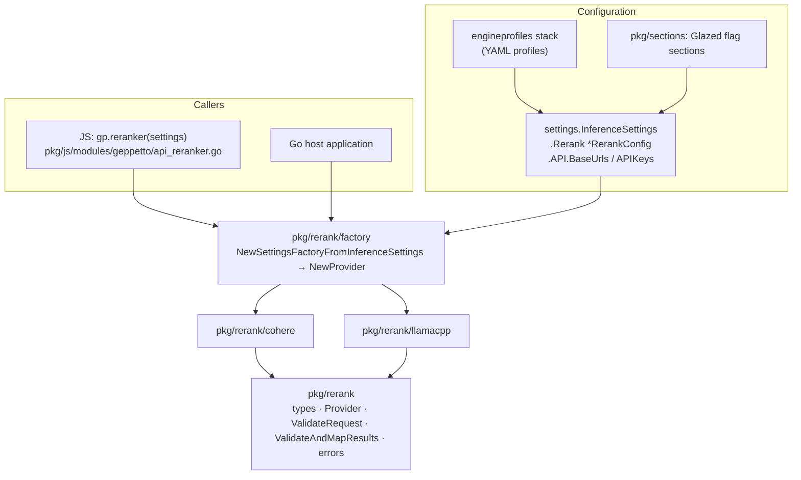

# Decision models in Geppetto: analysis, design and implementation

This guide explains what a decision model is, how the one we can reach today (LunaRoute's `djev`, served on the System One endpoint) is called, and how Geppetto will support it as its own modality. It is written for an engineer who knows Go but has not seen Geppetto's model-service packages before. By the end you should be able to explain why decisions get a new package instead of being squeezed into the chat engine, name every file the implementation touches, and implement any phase of the plan on your own.

The guide has five parts. Part 1 defines decision models and shows a real request and response. Part 2 documents the wire protocol, with evidence from probes we ran against the live service. Part 3 walks through how Geppetto already structures non-chat modalities (embeddings and rerank), because the decision package copies that structure. Part 4 is the design: types, validation, the HTTP adapter, configuration, Pi credentials and the JavaScript binding. Part 5 is the implementation plan, the tests, and the risks.

---

## Part 1 — What a decision model is

### 1.1 Generation versus decision

A chat model produces text one token at a time. If you ask it to classify something, you prompt it to emit a label, often as JSON, and then you parse what it wrote. Three problems follow from that. The output can be malformed or can name a label that does not exist. The model may spend hundreds of tokens reasoning before it answers (we measured 474 output tokens for an 80-word answer from `muse-spark-open` at thinking level `off` in RAGWB-006). And the label comes without a usable probability: the model says "semantic", and you do not know whether it was 51 % or 99 % sure.

A decision model does not generate. It is given a **state** (the thing being judged, as text or JSON) and a set of **questions** about that state. Each question declares its answer space up front, and the model returns a probability distribution over exactly that space. It cannot answer outside the space, there is nothing to parse, and every answer carries probabilities. The vendors describe these models as "System One" models, after the fast, intuitive mode of human judgment, as opposed to the slow deliberation an LLM performs when it reasons in text.

The known members of the family are:

- **Jev** (from TypeSafe): a hosted, closed-weight decision model, reachable through TypeSafe's API, through Braintrust, and through OpenRouter's Decisions API (the `jevkit` Python client wraps the latter). It charges only for input tokens.
- **djev** (on LunaRoute): a Jev-like decision model served on LunaRoute's gateway at `POST /v1/systemone`. LunaRoute's model page calls it "a System One decision model for classification, choices, and scoring". It is the model we have credentials for, so it is the one this ticket targets.
- **clef-flash** (on LunaRoute): a second model with the `systemone` capability. Our probe got a `502 systemone_backend_error` from it, so treat it as unavailable for now.

### 1.2 The three question types

Every decision model in this family supports the same three question types. They are worth learning precisely, because the whole API is built from them.

| Type | Answer space | What comes back | Typical use |
|---|---|---|---|
| `noul` | a proposition, true or false | `noul`: probability in [0, 1] that it is true | "Does this query need retrieval?", "Is this passage relevant?" |
| `choice` | 1–255 named options | `choice` (the top option), `confidence`, `probabilities` per option | "Which index should serve this query?" |
| `score` | an ordered rubric of up to 10 levels | `score` (fractional level), `confidence`, probabilities per level | "How complex is this question, 0–3?" |

The name `noul` is the vendors' term for a binary question; read it as "yes/no". A `score` is not a choice with numbered options: the levels are ordered, and the returned score is the expectation over level probabilities, so it can be fractional (1.9994 in the example below).

`confidence` for a choice is derived from the distribution, not predicted separately. One write-up gives the example of three options with a top probability of 0.8 yielding a confidence of 0.7. In other words, confidence measures how peaked the distribution is, normalised for the number of options.

### 1.3 A real request and response

This is the first probe we sent to `djev` (stored as `scripts/01-systemone-probe/q1.json`, response in `sources/01-systemone-probe-results.txt`). It asks three questions about one query, the same way a retrieval pipeline would before deciding what to do with it.

```json
{
  "model": "djev",
  "state": {
    "query": "how does the rebalance law preserve product placements?",
    "corpus": "engineering design notes for a warehouse slotting system"
  },
  "questions": {
    "route": {
      "type": "choice",
      "instructions": "Which retrieval strategy fits this query best?",
      "criteria": {
        "keyword": "Exact identifiers, names, error strings",
        "semantic": "Conceptual question needing paraphrase matching",
        "none": "Chit-chat or no retrieval needed"
      }
    },
    "needs_retrieval": {
      "type": "noul",
      "instructions": "Does answering require looking up documents?",
      "criteria": { "true": "Answer depends on corpus facts", "false": "Answerable without documents" }
    },
    "complexity": {
      "type": "score",
      "instructions": "How complex is the question?",
      "criteria": ["trivial lookup", "single fact", "explanation of one mechanism", "multi-document synthesis"]
    }
  }
}
```

The response came back in 428 ms (wall clock, including TLS):

```json
{
  "answers": {
    "route": {
      "type": "choice", "choice": "semantic", "confidence": 0.907,
      "probabilities": { "keyword": 0.021, "none": 0.0000125, "semantic": 0.979 }
    },
    "needs_retrieval": { "type": "noul", "noul": 0.994 },
    "complexity": {
      "type": "score", "score": 1.9994, "confidence": 0.959,
      "legend": { "0": "trivial lookup", "1": "single fact", "2": "explanation of one mechanism", "3": "multi-document synthesis" },
      "probabilities": { "0": 0.0008, "1": 0.0034, "2": 0.9915, "3": 0.0044 }
    }
  },
  "model": "djev",
  "usage": { "input_tokens": 228, "output_tokens": 16 }
}
```

Notice four properties that drive the design. Answers are keyed by the caller's question ids (`route`, `needs_retrieval`, `complexity`), not by position. Every answer repeats its `type`. Probabilities are complete over the declared space. And `output_tokens` is tiny (16 for three questions): the model is not writing.

### 1.4 Why batching questions matters

All questions in a request share one state, and the state is counted once for billing and once for latency. The second probe sent twelve "is this passage relevant to the query?" questions over one query, each question carrying one passage in its `instructions`. It came back in 639 ms with 659 input tokens. The six relevant passages scored between 0.99 and 1.0 and the six irrelevant ones between 0.0 and 0.02 (a passage about the slot solver, related but not about placement preservation, scored 0.02). A chat model asked to grade twelve passages would take several seconds and return text we would have to parse. This is the main reason decision models are interesting for retrieval pipelines, and it is the subject of the follow-up ticket in rag-workbench (RAGWB-007).

### 1.5 What decision models cannot do

The sources agree on the limits, and the implementation must not hide them:

- They do not generate text. A decision model cannot write an answer or a rewrite.
- They are weak at exact arithmetic, counting, date comparison and indirection.
- Results can depend on option order. One write-up reports a leading probability moving from about 0.85 to about 0.95 when options were reversed. Our encoder therefore preserves the caller's option order exactly (§4.3).
- Constrained outputs do not make them immune to prompt injection. The state is untrusted input.
- Model aliases such as `jev-latest` can change behind a fixed name. Thresholds tuned against one version may not hold for the next, so we record the model id that answered in every response.

---

## Part 2 — The LunaRoute System One protocol

This part is the reference for the adapter. Everything here comes from LunaRoute's documentation (`docs.lunaroute.com/api/systemone/`, `/models/`, `/api/models/`) and was checked against the live gateway with `scripts/01-systemone-probe/probe.py`. The probe reads the key from Pi's `~/.pi/agent/models.json` and never prints it.

### 2.1 Endpoint and authentication

- `POST https://gw.lunaroute.com/v1/systemone`, with `content-type: application/json`.
- The documentation's auth header is `LUNAROUTE-API-KEY: <key>`. `Authorization: Bearer <key>` is also accepted: our probe got `200` with both. The adapter sends `Authorization: Bearer`, because that is what Geppetto's `credentials.BearerTokenSource` produces and what Pi's credential lookup returns (§4.7).
- Requests are not streamed. One JSON body goes up, one comes back, usually in under a second.
- Compressed request bodies are rejected (`415`). The raw body is capped at 8 MiB for the route (`413` above that).

### 2.2 Request fields

| Field | Required | Shape | Notes |
|---|---|---|---|
| `model` | yes | string | A decision-model id, for example `djev`. Chat ids are rejected. |
| `state` | yes | string, object or array | What the questions are evaluated against. Image data URLs are not allowed inside it. |
| `images` | no | array of data URLs | At most one state image (vision-capable models only). JPEG, PNG or WebP; no remote URLs. |
| `questions` | yes | object, non-empty | Keys are caller-chosen ids, echoed in `answers`. Must be a record, not an array. |

Unknown top-level fields are rejected with `400`. Our probe confirmed it: adding `"options": {}` returned `{"error":{"code":"systemone_invalid_request","message":"unknown parameter \"options\""}}`.

A question object has `type` (`noul`, `choice`, `score`), `instructions` (required; a string, object or array) and `criteria`:

- `noul`: `criteria` is optional, and when present is `{"true": "...", "false": "..."}`. A noul with no criteria works: "The sky is green." with "Is the statement factually true?" returned 0.000115.
- `choice`: `criteria` is required, an object mapping option name to description, 1–255 entries. Omitting it returns `choice question "a" is missing "criteria"`.
- `score`: `criteria` is required, an array of level descriptions, at most 10. Level *i* is the *i*-th string.

Image options (data URLs inside `instructions`, choice criteria or noul criteria) are permitted on vision models, up to 6 attachments per request and 5 MiB decoded each. Score levels cannot contain images.

### 2.3 Response fields

```text
{
  model:   string                       // public model id that answered
  answers: { <question id>: Answer }
  usage:   { input_tokens, output_tokens }
  latency_ms?: number                   // documented; not present in our probe responses
}
Answer (noul)   = { type: "noul",   noul: p }
Answer (choice) = { type: "choice", choice: name, confidence: c, probabilities: { name: p } }
Answer (score)  = { type: "score",  score: s, confidence: c, legend: { "i": text }, probabilities: { "i": p } }
```

`latency_ms` is listed in the documentation but did not appear in any of our responses, so the adapter treats it as optional and measures wall-clock duration itself.

### 2.4 Errors

Errors use one envelope, `{"error": {"code", "message", "request_id"?}}`. The table merges the documentation with what we observed.

| Status | Code | Meaning | Observed? |
|---|---|---|---|
| 400 | `systemone_invalid_request` | Validation failed, a limit was exceeded, or a chat model id was used | yes (unknown field, missing criteria, empty questions, `glm-5.3`) |
| 402 | `insufficient_credits`, `reservation_too_large` | Wallet refused | no |
| 403 | `systemone_policy_disabled` | Not enabled for the org or plan | no |
| 404 | `model_not_found` | Unknown model id | yes (`nope`) |
| 408 | `body_read_timeout` | Body not received in time | no |
| 413 | `payload_too_large` | Over 8 MiB | no |
| 415 | `unsupported_content_encoding` | Compressed body | no |
| 429 | `systemone_gate_busy`, `systemone_backend_busy` | Capacity or upstream limits; carries `Retry-After` | no |
| 502 | `systemone_backend_error` | Upstream failure or unusable answer | yes (`clef-flash`) |
| 503 | `systemone_disabled`, `systemone_models_unavailable`, … | Platform-side unavailability | no |
| 504 | `systemone_deadline_exceeded` | Request outlived its deadline | no |

### 2.5 Discovery

There is no `/v1/systemone/models`. Decision models appear in `GET /v1/models` with `"capabilities": {"systemone": true, ...}`. Our probe found exactly two: `djev` (context 32 768, vision) and `clef-flash` (context 8 192, vision). Pi's catalog (`models-store.json`) lists `lunaroute/djev` too, but records it as an `openai-completions` model, because Pi has no notion of decision models. That mismatch matters in §4.7.

### 2.6 How this compares to the Jev API

The `jevkit` client documents OpenRouter's Decisions API for Jev. The question model is the same (`noul`, `choice`, `score`; a `questions` record over a shared `state`), and so is the answer nesting (`answers.<name>.noul`). Two surface differences show up in its examples: choice options are passed as an `options` array, and score levels as a `legend` object, where System One uses `criteria` for both. Because the shapes differ only at the edge, Geppetto's core types describe the *question model* and leave the field names to adapters. A future `openrouter` or `typesafe` adapter would translate the same `decision.Request` into its own JSON.

---

## Part 3 — How Geppetto structures a model-service modality

Geppetto has three model-service primitives today. A fourth should look like the newest of them, not like the oldest.

| Primitive | Core package | Interface | Adapters | Config section |
|---|---|---|---|---|
| Inference (chat) | `pkg/inference/engine` | `engine.Engine.RunInference(ctx, *turns.Turn)` | `pkg/steps/ai/{openai,claude,gemini,openai_responses}` | `ai-chat`, provider sections |
| Embeddings | `pkg/embeddings` | `embeddings.Provider.GenerateEmbedding / GenerateBatchEmbeddings` | in-package: `openai.go`, `ollama.go`, `cohere.go` | `embeddings` |
| Rerank | `pkg/rerank` | `rerank.Provider.Rerank(ctx, Request) (Response, error)` | `pkg/rerank/{llamacpp,llamacpp/qwen3,cohere}` | `rerank` |

### 3.1 The layering, using rerank as the example

Rerank was added in two tickets (GEPPETTO-RERANKER-001 and -002, in `ttmp/2026/…`), and its package comment (`pkg/rerank/doc.go`) states the rules this design follows. Its layers are:



Each layer has one job:

- **Core** (`pkg/rerank/rerank.go`, `validate.go`, `order.go`, `errors.go`) holds transport-neutral types, the `Provider` interface, request and response validation, and sentinel errors. It imports nothing provider-specific. Its rules are explicit: document ids are required and unique, `TopN` is explicit, provider indices are mapped back to caller ids, and results are deterministically ordered.
- **Adapters** (`pkg/rerank/cohere/provider.go`) speak one wire protocol. `New(Options)` validates the base URL (scheme, host, no userinfo, no dot segments), applies the outbound URL policy (`security.ValidateOutboundURL`), and clones the HTTP client so redirects are rejected. Each call encodes, enforces `MaxRequestBytes`, sends, reads at most `MaxResponseBytes`, decodes strictly (`DisallowUnknownFields`, no trailing data), validates through the core, and returns. Transport errors are replaced by a generic message wrapping `ErrUnavailable`, so a URL or header can never leak through an error string.
- **Factory** (`pkg/rerank/factory/settings_factory.go`) is the only place that knows which adapter a `type` string means and where its endpoint and key live in `APISettings` (`rerank-base-url`, `cohere-api-key`). It exists as a separate package to break the import cycle between core and adapters.
- **Config** (`pkg/rerank/config/settings.go` with `flags/rerank.yaml`) is the Glazed section: `rerank-type`, `rerank-engine`, and byte limits. Endpoints and keys deliberately do *not* live here. They live in the shared `APISettings` maps so profile stacking works the same for every modality.
- **Settings integration** (`pkg/steps/ai/settings/settings-inference.go`) adds `Rerank *rerankconfig.RerankConfig` to `InferenceSettings`, clones it, exports metadata, decodes it from parsed Glazed values (keeping it `nil` unless `type` or `engine` was set), and lists its slug among the sections whose API keys are decoded. `pkg/sections/sections.go` registers the section, and `pkg/cli/bootstrap/inference_debug.go` maps its fields for `--print-inference-settings` style debugging.
- **JS** (`pkg/js/modules/geppetto/api_reranker.go`, `api_reranker_async.go`) exposes `gp.reranker(settings)`. It accepts only a registry-resolved settings object, so JavaScript can never supply an endpoint or key. It returns an object with `rerank`, `rerankAsync` (a promise settled on the runtime owner thread through `postOnOwner`) and `model`.

One historical fix is worth knowing before you write the config struct. Commit `c135b09a` ("fix(rerank): preserve omitted fields in profile overlays") added `omitempty` to the YAML tags. Without it, a profile that overlays only `engine` serialised `type: ""` and wiped the base profile's type during stack merging. The decision config uses `omitempty` on every field from the start.

### 3.2 Where Pi fits

`pkg/steps/ai/providers/pi` reads Pi's agent directory (`~/.pi/agent`: `settings.json`, `models-store.json`, `models.json`, `auth.json`). `AgentDir.Resolve(ctx, "provider/id", opts)` produces chat `InferenceSettings` plus credential wiring. The private `credential(ctx, provider)` method returns a `credentials.BearerTokenSource` and, for static keys, the key itself, using Pi's precedence: `auth.json` first, then `models.json`'s `apiKey` (values may be `$ENV` or `!command` references). rag-workbench already uses this for chat (RAGWB-006). Decision support should reuse the same lookup, so a user who is logged into LunaRoute in Pi gets decisions without any extra configuration.

---

## Part 4 — Design

### 4.1 Goals and non-goals

Goals:

- A transport-neutral `pkg/decision` core with types that describe the question model (noul, choice, score), a `Provider` interface, request and response validation, and sentinel errors.
- A `pkg/decision/systemone` adapter for LunaRoute's endpoint, built to the same safety standard as the Cohere rerank adapter.
- Configuration through `InferenceSettings` and engine profiles, exactly like rerank.
- A Pi entry point: given `lunaroute/djev`, return a ready `decision.Provider` with Pi's credentials.
- A JavaScript binding, `gp.decider(settings)`, mirroring `gp.reranker`.

Non-goals:

- No streaming. The protocol has none.
- No retries inside the adapter. A `429` carries `Retry-After`, which the adapter surfaces in the error; whether and when to retry is the caller's decision, the same rule rerank follows.
- No model discovery call in this ticket. `GET /v1/models` capability parsing is a small follow-up.
- No routing or gating policy. Thresholds belong to the application (rag-workbench). The core offers only a pure helper (`Gate`) that applies thresholds a caller passes in.

### 4.2 Core types

```go
// pkg/decision/decision.go
package decision

type Type string

const (
	Noul   Type = "noul"   // probability that a proposition is true
	Choice Type = "choice" // one of 1–255 named options
	Score  Type = "score"  // a level on an ordered rubric of 1–10 levels
)

// Option is one choice option. Order is significant: decision models are
// sensitive to option order, so adapters must send options in this order.
type Option struct {
	Name        string `json:"name" yaml:"name"`
	Description string `json:"description,omitempty" yaml:"description,omitempty"`
}

// Question is one typed question about the request's state.
type Question struct {
	Type Type `json:"type" yaml:"type"`
	// Instructions says what to decide. A string, or JSON-encodable
	// structured data (map/slice) that adapters send as-is.
	Instructions any `json:"instructions" yaml:"instructions"`
	// Noul: optional descriptions of the true and false cases.
	True  string `json:"true,omitempty" yaml:"true,omitempty"`
	False string `json:"false,omitempty" yaml:"false,omitempty"`
	// Choice: the options, in the order the model should see them.
	Options []Option `json:"options,omitempty" yaml:"options,omitempty"`
	// Score: level descriptions, level 0 first.
	Levels []string `json:"levels,omitempty" yaml:"levels,omitempty"`
}

type Request struct {
	Model     string              `json:"model,omitempty" yaml:"model,omitempty"`
	State     any                 `json:"state" yaml:"state"`                       // string, map or slice
	Images    []string            `json:"images,omitempty" yaml:"images,omitempty"` // data URLs
	Questions map[string]Question `json:"questions" yaml:"questions"`
}

type Answer struct {
	Type Type `json:"type" yaml:"type"`
	// Noul: probability the proposition is true.
	Probability float64 `json:"probability,omitempty" yaml:"probability,omitempty"`
	// Choice: the most likely option and the distribution over options.
	Choice        string             `json:"choice,omitempty" yaml:"choice,omitempty"`
	Probabilities map[string]float64 `json:"probabilities,omitempty" yaml:"probabilities,omitempty"`
	// Score: fractional level in [0, len(Levels)-1] and per-level probabilities.
	Score              float64   `json:"score,omitempty" yaml:"score,omitempty"`
	LevelProbabilities []float64 `json:"level_probabilities,omitempty" yaml:"level_probabilities,omitempty"`
	// Choice and score: how peaked the distribution is, in [0, 1].
	Confidence float64 `json:"confidence,omitempty" yaml:"confidence,omitempty"`
}

type Usage struct {
	InputTokens  int `json:"input_tokens,omitempty" yaml:"input_tokens,omitempty"`
	OutputTokens int `json:"output_tokens,omitempty" yaml:"output_tokens,omitempty"`
}

type Response struct {
	Provider   string            `json:"provider" yaml:"provider"`
	Model      string            `json:"model" yaml:"model"`
	Answers    map[string]Answer `json:"answers" yaml:"answers"`
	Usage      *Usage            `json:"usage,omitempty" yaml:"usage,omitempty"`
	Cost       *float64          `json:"cost,omitempty" yaml:"cost,omitempty"`
	RequestID  string            `json:"request_id,omitempty" yaml:"request_id,omitempty"`
	DurationMs *int64            `json:"duration_ms,omitempty" yaml:"duration_ms,omitempty"`
}

type Model struct {
	Provider string `json:"provider" yaml:"provider"`
	Name     string `json:"name" yaml:"name"`
}

type Provider interface {
	Decide(ctx context.Context, in Request) (Response, error)
	Model() Model
}
```

Four design choices in these types deserve explanation.

**Typed criteria instead of a free `criteria` field.** The wire format overloads one field, `criteria`, with three shapes: an object of true/false for noul, an object of options for choice, and an array of levels for score. A Go caller should not have to build `map[string]any` and get the shape right by convention. `Question` therefore has `True`/`False`, `Options` and `Levels`, and validation rejects fields that do not belong to the question's type (a choice question with `Levels` set is an error, not ignored). The adapter maps them to `criteria`. This is also what makes a second adapter (OpenRouter's `options`/`legend` naming) a pure translation.

**Options are a slice, not a map.** Go maps have no order and `encoding/json` sorts map keys. If `Options` were a `map[string]string`, every request would present options alphabetically regardless of what the caller wrote, and because these models are order-sensitive (§1.5), probabilities would shift for reasons invisible to the caller. The slice keeps the caller's order, and the adapter writes the `criteria` object key by key in that order (§4.3).

**Score probabilities are a slice indexed by level.** The wire format keys them by the strings `"0"`, `"1"`, …. A slice indexed by level is the natural Go form, and validation guarantees it has exactly `len(Levels)` entries. The wire `legend` echo is dropped, since the caller already has `Levels`.

**`Response` mirrors `rerank.Response`.** It has the same `Provider`, `Model`, `Usage`, `Cost`, `RequestID` and `DurationMs` fields, with the same nil-versus-zero rules: `Cost` is nil when pricing is unknown and points at 0 when the call is known to be free. Code that logs or bills model-service calls can treat both modalities alike.

### 4.3 Validation and encoding rules

`ValidateRequest(in Request, configured Model) error` enforces, wrapping `ErrInvalidRequest`:

1. `Model` is empty (filled from the provider) or equals the configured model, the same model-drift rule rerank uses (`rerank.ResolveModel`).
2. `State` is non-nil. A string must be non-empty.
3. `Questions` has at least one entry. Every id is non-empty and at most 64 bytes of `[A-Za-z0-9_.-]`, so ids are safe to log and to echo in errors.
4. `Instructions` is a non-empty string, or a non-nil map or slice.
5. A noul may set `True`/`False` and nothing else. A choice must have 1–255 options with non-empty, unique names, and nothing else. A score must have 1–10 non-empty levels, and nothing else.
6. Each image is a `data:image/{jpeg,png,webp};base64,` URL.

Provider-specific limits (state size, input tokens, question count) are left to the server, which rejects with `400` rather than truncating. Duplicating them client-side would drift from the server.

`ValidateResponse(in Request, answers map[string]Answer) error` enforces, wrapping `ErrInvalidResponse`:

1. There is exactly one answer per question id: none missing, none extra.
2. Each answer's `Type` equals its question's type.
3. Every probability, confidence and score is finite. Probabilities and confidence lie in [0, 1], with a 1e-6 tolerance for rounding.
4. A choice's `Choice` is one of the declared option names, and every key of `Probabilities` is a declared option.
5. A score lies in [0, len(Levels)−1] (same tolerance) and has `len(Levels)` level probabilities.

The System One encoder writes `criteria` for a choice as an ordered JSON object. Go has no ordered map, so the encoder writes the bytes itself:

```go
// encodeOptions writes {"name1":"desc1","name2":"desc2",...} in slice order.
func encodeOptions(opts []decision.Option) json.RawMessage {
	var b bytes.Buffer
	b.WriteByte('{')
	for i, o := range opts {
		if i > 0 {
			b.WriteByte(',')
		}
		k, _ := json.Marshal(o.Name)        // escapes quotes, control characters
		v, _ := json.Marshal(o.Description) // "" when the caller gave none
		b.Write(k)
		b.WriteByte(':')
		b.Write(v)
	}
	b.WriteByte('}')
	return b.Bytes()
}
```

A unit test asserts that options `["z", "a", "m"]` reach the server in that order. That property is easy to lose in a refactor, and nothing else would catch it.

### 4.4 Errors

The core declares sentinels, as rerank does, and one structured error for provider failures:

```go
var (
	ErrInvalidRequest   = errors.New("invalid decision request")      // caller's request is malformed (client- or server-side)
	ErrInvalidResponse  = errors.New("invalid decision response")     // provider answered something unusable
	ErrUnavailable      = errors.New("decision provider unavailable") // transport failure, 5xx, timeouts
	ErrRateLimited      = errors.New("decision provider rate limited") // 429
	ErrNotGranted       = errors.New("decision access not granted")   // 401/402/403: key, credits, policy
	ErrModelNotFound    = errors.New("decision model not found")      // 404
	ErrRequestTooLarge  = errors.New("decision request too large")    // over MaxRequestBytes, or 413
	ErrResponseTooLarge = errors.New("decision response too large")
)

// ProviderError is a non-2xx response. It wraps one sentinel (Unwrap) so
// callers use errors.Is; Code and RetryAfter carry the provider's details.
type ProviderError struct {
	Status     int
	Code       string        // e.g. "systemone_invalid_request"
	Message    string        // provider's message, only for 400/404, capped at 200 bytes
	RequestID  string
	RetryAfter time.Duration // from Retry-After on 429/503
	kind       error
}
```

The safety contract is the same as rerank's. Errors never contain the state, question text, an authorization header, endpoint userinfo or a raw response body. The one exception, deliberately narrow, is the provider's `message` for `400` and `404`. Those messages are validation diagnostics such as `choice question "a" is missing "criteria"` or `unknown parameter "options"`, they name only question ids (which validation restricts to a safe alphabet), and without them a caller cannot fix a request the server rejected. They are capped at 200 bytes.

Status mapping:

| Status | Sentinel |
|---|---|
| 400 | `ErrInvalidRequest` |
| 401, 402, 403 | `ErrNotGranted` |
| 404 | `ErrModelNotFound` |
| 408, 5xx | `ErrUnavailable` |
| 413 | `ErrRequestTooLarge` |
| 415 | `ErrInvalidRequest` |
| 429 | `ErrRateLimited` |

### 4.5 The System One adapter

```go
// pkg/decision/systemone/provider.go
package systemone

const (
	ProviderName            = "systemone"
	DefaultBaseURL          = "https://gw.lunaroute.com/v1"
	DefaultMaxRequestBytes  = 8 << 20 // the gateway's route cap
	DefaultMaxResponseBytes = 1 << 20
)

type Options struct {
	BaseURL             string                        // API root; endpoint is BaseURL + "/systemone"
	APIKey              string                        // static key, or
	TokenSource         credentials.BearerTokenSource // a token source (Pi); exactly one is required
	Model               string
	HTTPClient          *http.Client
	OutboundURL         security.OutboundURLOptions
	MaxRequestBytes     int64
	MaxResponseBytes    int64
	CostPerMInputTokens *float64 // nil: cost unknown
}

func New(o Options) (*Provider, error)
func (p *Provider) Model() decision.Model
func (p *Provider) Decide(ctx context.Context, in decision.Request) (decision.Response, error)
```

`BaseURL` is the API root, ending in `/v1`, for two reasons. Pi stores LunaRoute's base URL as `https://gw.lunaroute.com/v1` (the OpenAI convention), so Pi's value can be passed unchanged. And every other OpenAI-compatible base URL in Geppetto follows the same convention.

The call path:

```mermaid
sequenceDiagram
  participant C as caller
  participant P as systemone.Provider
  participant V as pkg/decision (validate)
  participant G as gw.lunaroute.com
  C->>P: Decide(ctx, Request)
  P->>V: ValidateRequest(in, Model())
  V-->>P: ok / ErrInvalidRequest
  P->>P: encode wire JSON (ordered criteria); len ≤ MaxRequestBytes
  P->>P: token := TokenSource.BearerToken(ctx)
  P->>G: POST /v1/systemone (Authorization: Bearer …)
  alt non-2xx
    G-->>P: {"error":{code,message,request_id}}
    P-->>C: *ProviderError wrapping a sentinel
  else 200
    G-->>P: {model, answers, usage}
    P->>P: read ≤ MaxResponseBytes; strict decode
    P->>V: ValidateResponse(in, answers)
    P-->>C: Response{Provider, Model, Answers, Usage, Cost, DurationMs}
  end
```

Pseudocode for `Decide`:

```text
Decide(ctx, in):
    start ← now
    ValidateRequest(in, p.Model())                     -- ErrInvalidRequest
    wire ← { model: in.Model or p.model, state: in.State, images: in.Images,
             questions: { id: { type, instructions, criteria(q) } } }
    body ← json(wire); if len(body) > maxRequest → ErrRequestTooLarge
    token ← tokenSource.BearerToken(ctx)                -- failures → ErrNotGranted (no token text)
    resp ← client.Do(POST endpoint, body)               -- transport error → ErrUnavailable (generic text)
    raw, tooLarge ← readAtMost(resp.Body, maxResponse)  -- tooLarge → ErrResponseTooLarge
    if resp.Status ∉ 2xx → providerError(status, raw, Retry-After)
    w ← strictDecode(raw)                               -- unknown top-level fields tolerated, see below
    answers ← map wire answers to decision.Answer (score probabilities "i" → slice index i)
    ValidateResponse(in, answers)                       -- ErrInvalidResponse
    return Response{ Provider: "systemone", Model: w.model, Answers: answers,
                     Usage: w.usage, Cost: inputTokens × rate / 1e6 or nil,
                     RequestID: header X-Request-Id or w.request_id, DurationMs: now − start }
```

Strict decoding needs care here. The rerank adapters reject unknown fields everywhere, because their response format is fixed. The System One response is documented as growing (`latency_ms` is documented but absent today). The adapter therefore decodes the envelope and answer objects with known fields only, ignores unknown *top-level* fields, and still rejects trailing data and non-JSON bodies. The guarantee that matters, that every declared question has a well-formed answer, comes from `ValidateResponse`, not from the decoder.

The request id comes from the `X-Request-Id` response header (`01a1a8e2-…` in our probes) and falls back to the error envelope's `request_id`. Keeping it lets an operator quote one id to LunaRoute support.

### 4.6 Configuration and profiles

```go
// pkg/decision/config/settings.go
type DecisionConfig struct {
	Type             string `yaml:"type,omitempty" glazed:"decision-type"`     // "systemone"
	Engine           string `yaml:"engine,omitempty" glazed:"decision-engine"` // "djev"
	MaxRequestBytes  int64  `yaml:"max_request_bytes,omitempty" glazed:"decision-max-request-bytes"`
	MaxResponseBytes int64  `yaml:"max_response_bytes,omitempty" glazed:"decision-max-response-bytes"`
}
const DecisionSlug = "decision"
```

The section YAML (`pkg/decision/config/flags/decision.yaml`) declares the four flags, with byte-limit defaults of 8 MiB and 1 MiB.

`InferenceSettings` gains a `Decision *decisionconfig.DecisionConfig` field (YAML key `decision`, Glazed section `decision`), and the same five integration points rerank touched get one addition each:

1. `NewInferenceSettings`: `Decision: nil` (only present when configured).
2. `Clone`: deep-copy `Decision`.
3. `GetMetadata`: `decision-type`, `decision-engine`, and the limits.
4. `UpdateFromParsedValues`: decode into a temporary and keep it only when `type` or `engine` is set. Add `DecisionSlug` to `apiSlugs` so `systemone-api-key` and `systemone-base-url` decode into `APISettings`.
5. `pkg/sections/sections.go` registers the section, and `pkg/cli/bootstrap/inference_debug.go` maps `decision.*` field paths.

The endpoint and key live in the shared maps under adapter-specific names:

| Setting | Key | Default |
|---|---|---|
| API key | `api.api_keys["systemone-api-key"]` | required |
| Base URL | `api.base_urls["systemone-base-url"]` | `https://gw.lunaroute.com/v1` |
| Allow plain HTTP | `api.allow_http["decision"]` | false |
| Allow local networks | `api.allow_local_networks["decision"]` | false |

A profile for djev, stacked on a base profile that holds the key:

```yaml
profiles:
  lunaroute-base:
    inference_settings:
      api:
        api_keys:
          systemone-api-key: ${LUNAROUTE_API_KEY}
  djev:
    stack: [{ profile: lunaroute-base }]
    inference_settings:
      decision:
        type: systemone
        engine: djev
```

The factory follows rerank's shape exactly:

```go
// pkg/decision/factory/settings_factory.go
func NewSettingsFactoryFromInferenceSettings(s *settings.InferenceSettings) (*SettingsFactory, error)
func (f *SettingsFactory) NewProvider() (decision.Provider, error)
func (f *SettingsFactory) SupportedProviders() []string // ["systemone"]
func ValidateInferenceSettingsForDecision(s *settings.InferenceSettings) error
```

### 4.7 Pi credentials

Pi already knows how to authenticate to LunaRoute. The new entry point:

```go
// pkg/steps/ai/providers/pi/decision.go
type DecisionOptions struct {
	MaxRequestBytes, MaxResponseBytes int64
}

// Decider returns a decision provider for "provider/id" (for example
// "lunaroute/djev"), using the provider's base URL and Pi's credential.
// The catalog does not record whether a model is a decision model (Pi lists
// djev as openai-completions), so a chat id is accepted here and rejected by
// the server with systemone_invalid_request.
func (a *AgentDir) Decider(ctx context.Context, ref string, o DecisionOptions) (decision.Provider, error)
```

Steps:

1. `a.Catalog.Lookup(ref)`, or `ErrUnknownModel`. The `Supported` flag is not checked, since that flag means "a chat engine serves this API".
2. `src, _, err := a.credential(ctx, m.Provider)`: the same precedence and `$ENV`/`!command` resolution as chat. `NoCredentialError` passes through unchanged so callers can map it to "not granted".
3. Headers from `models.json` (`a.headers(ctx, m)`) wrap the HTTP client, as `Resolve` does.
4. `systemone.New(Options{BaseURL: first(m.BaseURL, systemone.DefaultBaseURL), TokenSource: src, Model: m.ID, HTTPClient, OutboundURL})`. When the agent dir was loaded with `WithLocalProviders()` (tests), the outbound policy allows HTTP and local networks.

This is the path rag-workbench will use: `--decide pi` plus a model ref.

### 4.8 The JavaScript binding

`gp.decider(settings)` mirrors `gp.reranker(settings)`:

```js
const gp = require("geppetto");
const settings = gp.profiles.resolve("djev");      // registry-resolved, no raw keys in JS
const d = gp.decider(settings);
const r = d.decide({
  state: { query: q },
  questions: {
    route: { type: "choice", instructions: "Which index fits?",
             options: { keyword: "exact identifiers", semantic: "concepts" } },
    needs: { type: "noul", instructions: "Needs documents?" },
  },
});
r.answers.route.choice;          // "semantic"
r.answers.needs.probability;     // 0.99
const h = d.decideAsync(req);    // { promise, cancel, close }
d.model();                       // { provider: "systemone", name: "djev" }
```

`options` may be an object, read in JavaScript insertion order through `goja.Object.Keys()` (never through `Export()`, which yields a Go map and loses the order), or an array of `{name, description}`. `levels` is an array of strings, and `true`/`false` are strings. Unknown keys are rejected so typos fail loudly, the same policy `decodeRerankOptions` applies. `decideAsync` settles its promise on the owner goroutine through `postOnOwner`, and the call is cancelled when the runtime's lifetime context ends.

---

## Part 5 — Implementation plan, tests and risks

### 5.1 Phases

| Phase | Deliverable | Files |
|---|---|---|
| 1 | Core types, validation, errors, `Gate` helper, tests | `pkg/decision/{doc,decision,validate,errors,gate}.go`, `*_test.go` |
| 2 | System One adapter with `httptest` tests and an opt-in live test | `pkg/decision/systemone/{provider,protocol}.go`, `provider_test.go`, `live_test.go` |
| 3 | Config section, factory, `InferenceSettings`, sections, debug map, profile-stack test | `pkg/decision/config/…`, `pkg/decision/factory/…`, `pkg/steps/ai/settings/settings-inference.go`, `pkg/sections/sections.go`, `pkg/cli/bootstrap/inference_debug.go`, `pkg/engineprofiles/stack_merge_decision_test.go` |
| 4 | `pi.AgentDir.Decider` and a test over a temporary agent dir | `pkg/steps/ai/providers/pi/decision.go`, `decision_test.go` |
| 5 | `gp.decider` JS binding with sync, async and model, plus tests | `pkg/js/modules/geppetto/api_decider.go`, `api_decider_test.go`, `module.go` |
| 6 | Help page and a smoke example against the live gateway | `pkg/doc/topics/16-decisions.md`, `cmd/examples/decision-pi-smoke/main.go` |

### 5.2 Tests that matter

- **Validation table tests**: one case per rule in §4.3, including a choice with `Levels`, 256 options, 11 levels, a duplicate option name, an empty instruction, an id with a space, and a non-data-URL image.
- **Order preservation**: options `z, a, m` reach a fake server in that order, read by scanning the raw request body.
- **Response validation**: a missing answer, an extra answer, a type mismatch, a choice outside the options, a probability of 1.5 or NaN, a score above the top level, and a wrong number of level probabilities.
- **Error mapping**: one fake-server case per status in §4.4, checking `errors.Is` against the sentinel, `ProviderError.Code`, `RetryAfter` from the header, and that an `Authorization` value planted in the server's error message never appears in the error string.
- **Limits**: a request over `MaxRequestBytes` never reaches the server, and a response over `MaxResponseBytes` fails with `ErrResponseTooLarge`.
- **Redirects**: a 302 is not followed.
- **Live test**: guarded by `GEPPETTO_LIVE_SYSTEMONE=1` and `LUNAROUTE_API_KEY`, sending the §1.3 request to djev.
- **Profile stacking**: a decision-only profile stacked on a base profile with the key resolves to both, and an overlay that sets only `engine` keeps the base `type` (the `omitempty` regression from §3.1).
- **Pi**: a temporary agent dir whose `lunaroute` provider points at an `httptest` server. `Decider("lunaroute/djev")` sends `Authorization: Bearer test-key` to `/v1/systemone`, and a provider without a credential returns `NoCredentialError`.
- **JS**: `decide` and `decideAsync` against a fake provider, object-key order preserved, unknown keys rejected.

### 5.3 Risks

- **Protocol drift.** System One is young; `latency_ms` is already documented but absent. Tolerating unknown top-level fields while validating answers strictly is the hedge.
- **Calibration claims are vendor claims.** The decision model reports probabilities; whether 0.8 means 80 % on *our* data is an empirical question for each use. rag-workbench should record decisions in its trace so they can be evaluated.
- **Order sensitivity.** Preserved by construction (§4.3), but callers should still test their critical questions with options reversed.
- **Injection.** The state is untrusted. A decision is an input to policy, not an authorization.

### 5.4 API reference summary

| Symbol | Kind | Purpose |
|---|---|---|
| `decision.Request`, `Question`, `Option`, `Answer`, `Response`, `Usage`, `Model` | types | Transport-neutral question model |
| `decision.Provider` | interface | `Decide(ctx, Request) (Response, error)`, `Model() Model` |
| `decision.ValidateRequest`, `ValidateResponse` | funcs | Invariants of §4.3 |
| `decision.Gate(p, act, confirm) GateAction` | func | `Act` / `Confirm` / `Reject` from a probability and caller thresholds |
| `decision.Err*`, `*ProviderError` | errors | Classification via `errors.Is`; `Code`, `RetryAfter` |
| `systemone.New(Options) (*Provider, error)` | func | LunaRoute System One adapter |
| `config.DecisionConfig`, `DecisionSlug` | type, const | Glazed section `decision` |
| `factory.NewSettingsFactoryFromInferenceSettings` | func | Profile-resolved construction |
| `pi.(*AgentDir).Decider(ctx, ref, DecisionOptions)` | method | Pi credentials → provider |
| `gp.decider(settings)` | JS | `{ decide, decideAsync, model }` |

### 5.5 File reference

Existing files to read first:

- `pkg/rerank/doc.go`: the design rules for a model-service primitive.
- `pkg/rerank/rerank.go`, `validate.go`, `errors.go`: core types and invariants.
- `pkg/rerank/cohere/provider.go`: the hosted-adapter template.
- `pkg/rerank/factory/settings_factory.go`: factory and settings validation.
- `pkg/rerank/config/settings.go`, `flags/rerank.yaml`: the config section.
- `pkg/steps/ai/settings/settings-inference.go`: `InferenceSettings` and its five integration points.
- `pkg/sections/sections.go` and `pkg/cli/bootstrap/inference_debug.go`: section registration and debug paths.
- `pkg/engineprofiles/stack_merge_rerank_test.go`: the profile-stacking tests to copy.
- `pkg/steps/ai/providers/pi/resolve.go`, `catalog.go`: Pi's catalog and credentials.
- `pkg/js/modules/geppetto/api_reranker.go`, `api_reranker_async.go`, `module.go`: the JS binding pattern.
- `pkg/doc/topics/15-reranking.md`: the help page to mirror.

Ticket artifacts:

- `scripts/01-systemone-probe/probe.py`, with request bodies `q1.json`, `relevance.json`, `e_*.json` and `ok_*.json`.
- `sources/01-systemone-probe-results.txt`: recorded responses and status lines.
- `sources/02-models-systemone-capability.txt`: the `/v1/models` entries with `systemone: true`.

---

## Part 6 — Implementation status and results

All six phases are implemented on branch `task/geppetto-decision-001`: 29 files and about 3 200 lines outside `ttmp`. The full suite passes (`go test ./...`, 55 packages), and so do `make lintmax` and the opt-in live test against djev.

| Phase | Commit | What landed |
|---|---|---|
| 1 | `f637be88` | `pkg/decision`: types, `ValidateRequest`/`ValidateQuestion`/`ValidateResponse`, sentinels plus `ProviderError`, `Gate`, `Answer.MarshalJSON` |
| 2 | `33f11d69` | `pkg/decision/systemone` with fake-server tests and `TestLive_DecideAgainstLunaRoute` |
| 3 | `dff707c9` | `pkg/decision/config`, `pkg/decision/factory`, `InferenceSettings.Decision`, section registration, debug paths, profile-stack tests |
| 4 | `a37bbe30` | `pi.(*AgentDir).Decider` |
| 5 | `bf13aeea` | `gp.decider` with `decide`/`decideAsync`/`model`, plus the `.d.ts` declarations |
| 6 | `4229f55f` | `pkg/doc/topics/16-decisions.md`, `cmd/examples/decision-pi-smoke` |

### 6.1 Where the implementation differs from Part 4

- **`Answer` JSON.** With `omitempty`, a noul answer of probability 0 serialised as `{"type":"noul"}`. `Answer.MarshalJSON` now writes exactly the fields of the answer's type, zero values included.
- **Optional section decode.** Glazed's `DecodeSectionInto` fails with `section decision not found` when a host did not register the section. `UpdateFromParsedValues` checks `parsedValues.Get(DecisionSlug)` first and treats absence as "not configured". Rerank has no such guard.
- **Section defaults.** `pkg/sections` seeds the decision section from `NewDecisionConfig()`, so `--help` and parsed values show the 8 MiB and 1 MiB limits rather than 0.
- **Credential flags.** `systemone-api-key` and `systemone-base-url` are flags of the decision section. The existing `*-api-key`/`*-base-url` wildcard decode places them in `APISettings`.
- **Provider error codes** pass through `safeCode` (`[a-z0-9_]{1,64}`), so a code field cannot carry a token.
- **The smoke example is a Glazed command** (`decision-pi-smoke run`). The repository's glazed-lint rejects raw Cobra flags and `os.Getenv` in CLI code.
- **JS options** accept three forms: an object in insertion order (read through `goja.Object.Keys()`), an array of names, or an array of `{name, description}`.

### 6.2 Measurements

| Call | Questions | Input tokens | Wall clock |
|---|---|---|---|
| Probe §1.3 (routing set), djev | 3 | 228 | 428 ms |
| Live test (same set, no corpus in state) | 3 | 209 | 311 ms |
| `decision-pi-smoke run` through Pi | 3 | 231 | 403 ms |
| Smoke example, two passages | 2 | — | 635 ms |
| 12 short passages (probe) | 12 | 659 | 639 ms |
| 40 questions | 40 | — | `400 "questions" exceeds this model's max_questions of 32` |

The 32-question limit was found later, by the rag-workbench spike (RAGWB-007). LunaRoute's documentation does not state it. The core does not enforce it, because it is a model limit that the server reports. Callers that batch (rag-workbench's `filter.decide`/`rerank.decide`) cap batches at 32.

Two answers show how much the state matters. Asked "does answering require documents?", djev gave 0.994 when the state described the corpus and the question had true/false criteria. With neither, it gave 0.084.

### 6.3 Follow-ups

- Capability discovery from `GET /v1/models` (`capabilities.systemone`).
- A timeout on Pi-built HTTP clients. `withHeaders(nil, …)` returns a client without one, so Pi deciders rely on the caller's context deadline.
- An OpenRouter or TypeSafe adapter for Jev proper.
