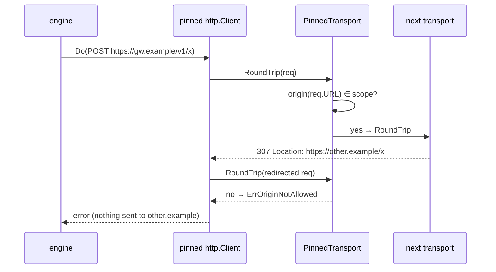
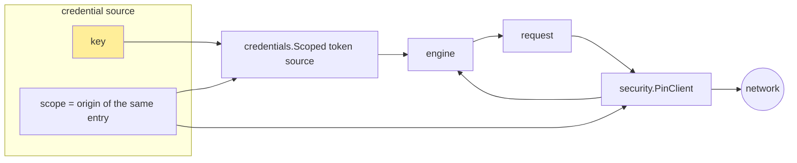

# Credential scoping in Geppetto: analysis, design and implementation

## 1. Executive summary

Geppetto sends API keys to model providers. In several places today, a key that belongs to one provider can be sent to a host that belongs to another provider, or to a host the key's owner never configured. A probe program in this ticket, which records requests without any real network traffic, reproduces six such paths:

- an OpenAI-compatible Pi provider's key sent to `api.openai.com`;
- an Anthropic-compatible Pi provider's key sent to `api.anthropic.com`;
- a gateway key used for OpenAI embeddings sent to `api.openai.com`, even though the profile points `openai-base-url` at the gateway;
- an Open Responses key paired with a URL taken from a different settings slot;
- Claude's `x-api-key` sent on to a second host after an HTTP redirect;
- Pi's `models.json` headers sent on to a second host after an HTTP redirect.

Each path was fixed or worked around locally in the past, or not at all. They share one cause: **the code that obtains a secret and the code that chooses where the secret goes are separate and do not know about each other.** Each has its own fallbacks, so a fallback on either side can join a key to the wrong host.

This guide proposes removing the bug class with two mechanisms:

1. **Every credential gets a scope.** The scope is the set of origins (scheme, host, port) that the credential may be sent to. It is computed where the secret is obtained, from the same configuration entry.
2. **The HTTP client enforces the scope.** The client that carries a credential is *pinned*: its transport refuses any request whose URL origin is outside the scope. This includes requests created by redirects.

With both in place, a wrong default, a normalization mismatch, a slot mix-up or a redirect makes the request fail. It never carries the key to another host. The rest of the guide explains the system you need to understand first, the evidence, the design and its decision records, and a phased implementation plan with tests.

## 2. Problem statement and scope

### 2.1 The triggering bug

PR #444 (GEPPETTO-DECISION-001) added `pi.AgentDir.Decider`, which builds a decision-model provider from Pi's credentials. Its first version computed the endpoint as `first(m.BaseURL, systemone.DefaultBaseURL)`. For a model whose provider was not LunaRoute and had no `baseUrl`, the result was that provider's key paired with LunaRoute's URL. Codex review found it. The first fix compared the raw string with `""`. Codex then found that `" "` and `"/"` got past that check, because `systemone.New` trims the URL and *then* applies its own default. A second fix checked the normalized value.

Both fixes were correct, but each patched one call site. The question the user asked was the right one: why is this bug possible to write at all?

### 2.2 Scope of this ticket

In scope:

- Every place in Geppetto where a provider credential (API key, bearer token, OAuth access token, or a secret header) is attached to an outbound HTTP request:
  - inference engines: OpenAI chat, OpenAI Responses, Claude, Gemini, Codex;
  - token counting: Claude, Responses;
  - embeddings: OpenAI, Cohere, Ollama;
  - rerank: Cohere, llama.cpp;
  - decision: System One;
  - the Pi bridge: `pkg/steps/ai/providers/pi`.
- The invariant, its enforcement, the changes to endpoint resolution, and a regression test that covers all of these paths.

Out of scope, recorded as follow-ups:

- Profile *stack* merging across profiles (one profile's key combined with another profile's URL). Section 11 discusses why it is deferred.
- OAuth token endpoints (`auth.openai.com`), which are separate clients with fixed URLs.

## 3. System orientation

This section defines the terms the rest of the guide uses, and shows how a request is assembled today.

### 3.1 Terms

- **Credential.** The secret material that authenticates a request: an API key, a bearer token, or an OAuth access token. In Geppetto it lives in one of three places:
  - a string in `settings.APISettings.APIKeys` (for example `APIKeys["openai-api-key"]`);
  - a `credentials.BearerTokenSource` passed to an engine as an option;
  - a header value that the Pi bridge resolves from `models.json` (for example `x-team: ${TEAM}`).
- **Base URL.** The root URL of a provider's API, for example `https://api.openai.com/v1`. An engine appends an operation path to it (`/chat/completions`, `/v1/messages`, `/systemone`) to get the **endpoint**.
- **Origin.** The scheme, host and port of a URL. `https://api.openai.com/v1/chat/completions` has origin `https://api.openai.com:443`. This is the unit browsers use as a security boundary, and the unit this design scopes credentials to. The path is not part of the origin.
- **Slot.** A settings key pair named after an API type: `openai-api-key` with `openai-base-url`, `claude-api-key` with `claude-base-url`, and so on. Profiles and CLI flags write slots, and engines read them.
- **Layer.** A level of settings precedence. Examples: the top-level `inference_settings.api` maps, and the embeddings-local `embeddings.api_keys`/`base_urls` that override them.
- **Pi bridge.** `pkg/steps/ai/providers/pi`. It reads a Pi coding-agent directory (`~/.pi/agent`: `auth.json`, `models.json`, `models-store.json`, `settings.json`) and turns a model reference such as `fireworks/glm-5` into a Geppetto engine (`Resolve`) or a decision provider (`Decider`).
- **Default URL.** A URL that some layer fills in when the configuration has none: a YAML flag default, an adapter constant such as `systemone.DefaultBaseURL`, or a `first(m.BaseURL, "https://…")` expression.
- **Scope** (new in this design). The set of origins a credential may be sent to.
- **Pinned client** (new). An `*http.Client` whose transport refuses requests outside a scope.

### 3.2 How a request is assembled today

```mermaid
flowchart LR
  subgraph Config
    P[profile YAML / CLI flags<br/>api_keys, base_urls]
    PI[Pi agent dir<br/>auth.json, models.json]
  end
  subgraph Resolution
    S[settings.InferenceSettings<br/>APIKeys / BaseUrls slots]
    PB[pi.Resolve / pi.Decider<br/>credential(provider)<br/>first(m.BaseURL, default)]
  end
  subgraph Engine
    E[engine / adapter<br/>reads slot or option<br/>may apply its own default URL]
  end
  subgraph HTTP
    C[http.Client<br/>EnsureHTTPClient: often http.DefaultClient<br/>follows redirects]
  end
  P --> S --> E
  PI --> PB --> S
  PB -->|BearerTokenSource / headers| E
  E -->|endpoint + secret headers| C --> NET((network))
  style NET fill:#fdd
```

There are two kinds of input. Profiles fill settings slots. The Pi bridge fills settings slots *and* passes credentials through engine options and an HTTP client that adds headers. The engine reads a key and a URL, sometimes from different slots, sometimes applying its own default URL. Finally an `http.Client` sends the request and follows redirects.

Notice what is missing from the diagram: no component knows which host a given key belongs to. `credentials.Request{Provider, BaseURL}` is passed to `BearerToken`, so a token source *could* check the destination. But the only source the Pi bridge uses, `StaticBearerTokenSource`, ignores it (`pkg/steps/ai/credentials/static.go:25`).

### 3.3 A representative example

Take one Pi provider entry in `~/.pi/agent/models.json`:

```json
{ "providers": { "fireworks": {
    "api": "openai-completions",
    "apiKey": "FW-SECRET",
    "models": [{ "id": "m" }] } } }
```

It has a key but no `baseUrl`. Here is what happens today when a host calls `agent.Resolve(ctx, "fireworks/m", …)` and runs the engine:

1. `Catalog.Lookup` finds the model. `m.BaseURL` is `""` (`pkg/steps/ai/providers/pi/catalog.go:147,155`).
2. `a.credential(ctx, "fireworks")` returns a static source for `FW-SECRET` (`resolve.go:175–208`).
3. `m.API` is `openai-completions`, so the bridge sets `s.API.BaseUrls["openai-base-url"] = first(m.BaseURL, "https://api.openai.com/v1")` (`resolve.go:136`).
4. The OpenAI engine reads that slot, builds `https://api.openai.com/v1/chat/completions`, calls `BearerToken` (the static source ignores the URL) and sets `Authorization: Bearer FW-SECRET` (`openai/chat_stream.go:64–116,166`).

The probe output (section 4.3) shows exactly that request. In the proposed design, step 3 computes the endpoint from the *provider*: `fireworks` has no `baseUrl` and is not in the default table, so `Resolve` returns an error and nothing is sent. Had a wrong URL been produced anyway, the pinned client would refuse it at send time.

## 4. Current-state analysis

### 4.1 Where credentials are obtained

| Source | Code | What it produces |
|---|---|---|
| Profile/CLI slots | `pkg/steps/ai/settings/settings-inference.go` (`APISettings.APIKeys`, `BaseUrls`) | strings keyed by slot name |
| YAML flag defaults | `settings/openai/chat.yaml:24–27`, `settings/claude/claude.yaml:13–16`, `settings/gemini/gemini.yaml:5–8` | default URLs for `openai-base-url`, `claude-base-url`, `gemini-base-url` |
| Pi `credential()` | `providers/pi/resolve.go:175–208` | `StaticBearerTokenSource` plus the raw key, looked up by **provider** |
| Pi `headers()` | `providers/pi/resolve.go:210–223` | `models.json` header values, which may be secrets |
| Pi `withHeaders()` | `providers/pi/resolve.go:227–` | an `http.Client` whose transport adds those headers to **every** request |
| Bearer sources | `credentials/bearer.go:67–83`, `static.go` | a token chosen at send time from `Request{Provider, BaseURL}` |
| Codex | `providers/pi/codex.go:49–`, `providers/openaicodex/codex.go:66–126` | an OAuth source, with a route resolver that **only accepts `chatgpt.com`** |

The Codex row matters: it is an existing instance of the pattern this guide proposes. `openaicodex.Route.Resolve` validates that the base URL is exactly `https://chatgpt.com/backend-api` (`codex.go:97–126`). Its comment states the reason: "This prevents a profile-configured URL from redirecting subscription credentials to an arbitrary HTTPS host." Today that protection exists for Codex only.

### 4.2 Where endpoints are chosen, and where defaults are applied

| Path | Code | Default if the URL is empty |
|---|---|---|
| Pi → OpenAI chat / Responses | `pi/resolve.go:136` | `https://api.openai.com/v1`, keyed by **protocol** |
| Pi → Claude | `pi/resolve.go:146` | `https://api.anthropic.com`, keyed by **protocol** |
| Pi → Gemini | `pi/resolve.go:164` | none set, so the Gemini SDK uses Google's endpoint |
| Pi → Codex | `pi/resolve.go:114` | `https://chatgpt.com/backend-api` |
| Pi → Decider | `pi/decision.go` (after #444) | `systemone.DefaultBaseURL`, only for provider `lunaroute` |
| OpenAI chat engine | `openai/chat_stream.go:64–66` | none: an error (good) |
| Responses engine | `openai_responses/provider_settings.go:48–63` | `https://api.openai.com/v1`, after trying three slots **independently of the key's three slots** (`:36–45`) |
| Claude engine / token count | `claude/engine_claude.go:79`, `claude/token_count.go:68–71` | `https://api.anthropic.com` (token count); the engine relies on the YAML default |
| Gemini | `gemini/modern_engine.go:32`, `engine_gemini.go:88` | SDK default |
| OpenAI embeddings | `embeddings/settings_factory.go:148–159`, `embeddings/openai.go:19–31` | **the base URL is never read**; go-openai always uses `api.openai.com` |
| Cohere embeddings / rerank | `embeddings/cohere.go:32`, `rerank/cohere/provider.go:27,94` | `https://api.cohere.com` |
| llama.cpp rerank | `rerank/factory/settings_factory.go:141–150` | none: an error (good) |
| System One | `decision/systemone/provider.go` (`New`, `NormalizeBaseURL`) | `https://gw.lunaroute.com/v1` |
| JS engine factory | `js/modules/geppetto/api_engines.go:95` | sets `claude-base-url` to `https://api.anthropic.com` when missing |

### 4.3 Evidence: the probe

`scripts/01-leak-probe/main.go` replaces `http.DefaultTransport` with a recorder that answers every request itself, so nothing leaves the process. It then drives each path with secrets that are recognizable markers. The recorded output is in `sources/01-leak-probe-output.txt`:

```text
== pi.Resolve fireworks/m (openai-completions, no baseUrl)
   api.openai.com               /v1/chat/completions         markers=[FW-SECRET]
== pi.Resolve zai/m (anthropic-messages, no baseUrl)
   api.anthropic.com            /v1/messages                 markers=[ZAI-SECRET]
== pi.Resolve gateway/m, gateway answers 307 to other.example
   gateway.example              /v1/chat/completions         markers=[GW-SECRET TEAM-SECRET]
   other.example                /v1/chat/completions         markers=[TEAM-SECRET]
== embeddings openai, openai-base-url=https://gateway.example/v1
   api.openai.com               /v1/embeddings               markers=[GW-SECRET]
== open-responses key, only openai-base-url set
   gateway.example              /v1/responses                markers=[OR-SECRET]
== claude, gateway answers 307 to other.example
   gateway.example              /v1/messages                 markers=[CL-SECRET]
   other.example                /v1/messages                 markers=[CL-SECRET]
== pi.Decider fireworks/m, baseUrl " " (after #444 fixes)
   (no request sent)
```

How to read it:

- **Rows 1 and 2:** a key reaches the vendor of the wire protocol instead of the provider that issued it.
- **Row 3:** on a cross-host redirect, Go's `http.Client` strips `Authorization` (so `GW-SECRET` did not leak), but it forwards custom headers. `TEAM-SECRET` arrived at `other.example`. The Go documentation for `http.Client` states this behaviour: only `Authorization`, `WWW-Authenticate` and `Cookie` are treated as sensitive.
- **Row 4:** a gateway key reaches OpenAI, because the OpenAI embeddings provider ignores `openai-base-url`. This happens with plain profiles; Pi is not involved.
- **Row 5:** the Open Responses key and the URL come from different slots.
- **Row 6:** Claude's `x-api-key` is a custom header, so it is forwarded on redirect.
- **Row 7:** the PR #444 fix holds.

The real Pi catalog on the development machine was also checked, by reading provider names and URLs only, never keys. All 215 models in `models-store.json` and all 7 in `models.json` have a `baseUrl`. So rows 1 and 2 need a configuration without `baseUrl`, such as a hand-written `models.json` entry, while rows 3–6 can happen with ordinary configurations.

### 4.4 Inventory

| # | Path | Failure | Mechanism | Evidence |
|---|---|---|---|---|
| 1 | Pi → Decider | foreign key to LunaRoute | adapter default URL | fixed in #444; row 7 above |
| 2 | Pi → chat engines | provider key to the protocol vendor | protocol-keyed default | probe rows 1–2 |
| 3 | OpenAI embeddings | gateway key to OpenAI | base URL never read | probe row 4 |
| 4 | Responses | key and URL from different slots | independent fallback chains | probe row 5 |
| 5 | Embeddings layers | local key with top-level URL | per-field layer merge | code reading (`embeddings/settings_factory.go:276–306`) |
| 6 | Pi headers | secret header on redirect | header added to every hop | probe row 3 |
| 7 | Claude, Gemini (custom client) | `x-api-key` or `?key=` on redirect | non-standard auth carriers | probe row 6; Gemini by code reading (`engine_gemini.go:45–76`) |

## 5. Gap analysis: why this bug class exists

Each row has its own surface cause, but there are four underlying ones.

1. **Independent lookups with independent fallbacks.** The secret is found by one key (provider name, slot name, layer) and the URL by another (protocol, slot, adapter constant). Each side has fallbacks. Nothing forces the two to agree, so any fallback on either side can produce a mismatched pair.
2. **The value checked is not the value used.** Validation and use apply different normalization (#444's `" "` case), or different layers apply defaults after a check has passed. A guard placed before the last default can never be complete.
3. **Credentials are attached to every hop.** Transports that add headers (Pi `headerTransport`, Gemini `geminiAPIKeyTransport`) and clients that follow redirects (`http.DefaultClient`) attach secrets to requests whose URL nobody validated. `security.ValidateOutboundURL` runs once, on the first URL (`claude/api/messages.go:181`, `openai/chat_stream.go:69`), and sees no redirects.
4. **No representation of "where this key belongs".** `credentials.Request` carries the destination at token time, but no source compares it with anything. Static keys in settings have no destination attached at all.

Adding more guards at call sites fixes rows one at a time. Only cause 4 can be fixed in one place, and fixing it makes causes 1–3 harmless: a wrong pair or an unvalidated hop is refused.

## 6. Proposed architecture

### 6.1 The invariant

> **A credential may only be sent to an origin in its scope. The scope is fixed where the credential is obtained, from the same configuration entry. Every request that carries the credential is checked against the scope just before it is sent, including requests produced by redirects.**

### 6.2 Mechanism A: origin-pinned HTTP clients (enforcement)

The component that carries a credential is the `http.Client` an engine sends with. Each client is built for one model, endpoint or provider: the Pi bridge builds one per `Resolve`/`Decider`, and engines build one per settings slot. So the client can be pinned to that entry's origins. A pinned client refuses *any* request whose origin is not allowed. It does not need to know which headers are secret, so it also covers `x-api-key`, `?key=`, and arbitrary `models.json` headers.



`http.Client` calls `Transport.RoundTrip` once per hop. A check in the transport therefore sees every redirect, which a check before `Do` cannot.

### 6.3 Mechanism B: scope derived at the credential's source

Pinning only helps if the scope is right. The scope must come from where the key came from, *not* from the URL the engine chose. Otherwise a wrong default URL would simply be pinned and allowed.

- **Pi bridge.** The scope is the origin of the provider's normalized `baseUrl`. If there is none, it is the provider's own default from a small table *keyed by provider* (`openai`, `anthropic`, `google`, `openai-codex`, `lunaroute`). Otherwise the result is an error. Protocol-keyed defaults are removed. The same computed URL is used as the engine's base URL, so check and use cannot diverge.
- **Settings slots.** The key in slot `X` is scoped to the URL in slot `X`, or to slot `X`'s documented default. Engines resolve **the key and the URL as a pair from the same slot** (Responses today does not), and pin their client to that URL's origin. For profile-configured keys, slot pairing is the only signal of intent, so pairing and pinning together give the guarantee.
- **Bearer token sources** (defense in depth). `credentials.Scoped(source, origins…)` wraps a source and refuses to *produce* a token when `Request.BaseURL` is outside the scope. The Pi bridge wraps its sources. A token that is never produced cannot leak, even through a code path that builds its own client.



### 6.4 APIs

New, in `pkg/security`:

```go
// Origin is the scheme, host and port a credential is scoped to.
type Origin struct{ Scheme, Host, Port string } // lower-case; default ports kept explicit

// ParseOrigin parses an absolute http(s) URL. Empty, relative, userinfo-bearing
// or non-http(s) URLs are errors.
func ParseOrigin(raw string) (Origin, error)
func OriginOf(u *url.URL) (Origin, error)
func (o Origin) String() string // "https://api.openai.com:443"

// ErrOriginNotAllowed: a request or token was refused because its origin is outside the credential's scope.
var ErrOriginNotAllowed = errors.New("origin not allowed for this credential")

// PinnedTransport refuses requests outside Allowed and forwards the rest.
// A nil Next means http.DefaultTransport, read at request time.
type PinnedTransport struct {
    Next    http.RoundTripper
    Allowed []Origin
}
func (t *PinnedTransport) RoundTrip(*http.Request) (*http.Response, error)

// PinClient returns a shallow copy of base (nil means a new &http.Client{})
// whose Transport is wrapped in a PinnedTransport. base is never modified.
func PinClient(base *http.Client, allowed ...Origin) *http.Client
```

New, in `pkg/steps/ai/credentials`:

```go
// Scoped wraps src. BearerToken (and BearerTokenAfterUnauthorized, when src
// implements it) return ErrOriginNotAllowed (wrapped in ErrUnavailable) when
// Request.BaseURL's origin is not allowed.
func Scoped(src BearerTokenSource, allowed ...security.Origin) BearerTokenSource
```

New, in `pkg/steps/ai/settings`:

```go
// EnsurePinnedHTTPClient is EnsureHTTPClient pinned to baseURL's origin.
// Engines that attach a slot's key use it instead of EnsureHTTPClient.
func EnsurePinnedHTTPClient(cs *ClientSettings, baseURL string) (*http.Client, error)
```

Changed, in `pkg/steps/ai/providers/pi`:

```go
// endpoint returns the provider-scoped base URL: the model's normalized
// baseUrl, else the provider default from providerDefaultBaseURLs, else
// NoEndpointError. Resolve and Decider both use it.
func (a *AgentDir) endpoint(m Model) (baseURL string, origin security.Origin, err error)

var providerDefaultBaseURLs = map[string]string{
    "openai":       "https://api.openai.com/v1",
    "anthropic":    "https://api.anthropic.com",
    "google":       "https://generativelanguage.googleapis.com",
    "openai-codex": "https://chatgpt.com/backend-api",
    "lunaroute":    "https://gw.lunaroute.com/v1",
}

type NoEndpointError struct{ Model, Provider string }
```

## 7. Decision records

### Decision: pin the whole client, do not filter secret headers

- **Context:** Secrets travel as `Authorization`, `x-api-key`, `?key=` and arbitrary `models.json` headers.
- **Options considered:** (a) strip a list of secret headers on foreign hops; (b) refuse every request outside the scope.
- **Decision:** (b).
- **Rationale:** a header list is never complete (`models.json` headers are user-defined), and stripping hides misconfiguration. Each client is built for one provider's entry, so it has no legitimate reason to contact another origin.
- **Consequences:** a provider that redirects API calls to another origin stops working, with a clear error. Such a provider must be configured with both origins (the scope is a list) or with its final URL.
- **Status:** accepted.

### Decision: refuse, do not strip

- **Context:** what to do when a hop is out of scope.
- **Options considered:** strip the credential and continue; return an error.
- **Decision:** return an error that wraps `security.ErrOriginNotAllowed`.
- **Rationale:** a request sent without credentials to an unknown host still discloses the request body (prompts, documents). Failing closed and loudly makes the misconfiguration visible.
- **Consequences:** callers see a new error kind. `errors.Is(err, security.ErrOriginNotAllowed)` identifies it.
- **Status:** accepted.

### Decision: scope by origin, not by path prefix

- **Context:** should `https://host/v1` also allow `https://host/other`?
- **Options considered:** origin; origin plus base-path prefix.
- **Decision:** origin.
- **Rationale:** engines legitimately use paths outside the configured base path (Claude token counting uses `/v1/messages/count_tokens` with base `https://api.anthropic.com`; Codex rewrites the path). The origin is the boundary that the transport layer and browsers enforce.
- **Consequences:** multi-tenant gateways that separate tenants by path (for example `/v1/{account}/{gateway}`) are not isolated from each other. See open questions.
- **Status:** accepted.

### Decision: the Pi bridge resolves endpoints by provider and drops protocol defaults

- **Context:** rows 1–2. The wire protocol says nothing about who issued a key.
- **Options considered:** keep protocol defaults and add guards; a provider-keyed table; require `baseUrl` everywhere.
- **Decision:** use the normalized `baseUrl`, else a provider-keyed table of first-party defaults, else `NoEndpointError`.
- **Rationale:** the default URL then belongs to the same provider as the key, by construction. All 222 models in the real catalog have a `baseUrl`, so the table only covers hand-written first-party entries.
- **Consequences:** a hand-written third-party entry without `baseUrl` that used to "work" by sending its key to OpenAI or Anthropic now fails with `NoEndpointError`. That is intended.
- **Status:** accepted.

### Decision: Responses resolves key and URL from the same slot

- **Context:** row 4. `responsesAPIKey` and `responsesBaseURL` each try `open-responses`, `openai-responses` and `openai`, independently.
- **Decision:**
  1. Pick the slot first: the first slot with a key, or, when a token source supplies the credential, the first slot with a URL.
  2. Read both the key and the URL from that slot.
  3. The OpenAI default URL applies only to the `openai` and `openai-responses` slots.
- **Rationale:** this applies slot pairing (Mechanism B) to the one engine that mixes slots.
- **Consequences:** an `open-responses` key with no `open-responses-base-url` becomes an error instead of going to whichever URL the other chain found.
- **Status:** accepted.

### Decision: OpenAI embeddings honour `openai-base-url`

- **Context:** row 3. Chat honours `openai-base-url`; embeddings silently ignore it.
- **Decision:** pass the slot's URL to go-openai (`ClientConfig.BaseURL`), with a pinned client.
- **Rationale:** the same slot must mean the same endpoint for every modality. This is the only reading under which the key-to-URL pairing is well defined.
- **Consequences:** this is a behaviour change. A profile that points `openai-base-url` at a chat-only gateway but expected embeddings from OpenAI must now configure embeddings separately (embeddings-local `base_urls.openai-base-url`).
- **Status:** accepted.

### Decision: defer cross-layer pairing for embeddings (row 5)

- **Context:** embeddings-local keys and URLs override top-level values one field at a time.
- **Options considered:** pair key and URL by layer; keep per-field merge.
- **Decision:** keep per-field merge in this ticket. Pin the embeddings client to the URL that is actually used.
- **Rationale:** both layers are written by the same user in the same profile file, and a key-only local override relying on a top-level URL is a plausible intended configuration. Pinning still stops redirect leaks.
- **Consequences:** row 5 stays possible in principle. It is recorded as an open question.
- **Status:** accepted for now.

## 8. Pseudocode and key flows

### 8.1 PinnedTransport

```go
func (t *PinnedTransport) RoundTrip(req *http.Request) (*http.Response, error) {
    o, err := OriginOf(req.URL)
    if err != nil || !slices.Contains(t.Allowed, o) {
        if req.Body != nil { req.Body.Close() } // RoundTripper contract
        return nil, fmt.Errorf("%s: %w", redact(req.URL), ErrOriginNotAllowed) // host only, no query
    }
    next := t.Next
    if next == nil { next = http.DefaultTransport }
    return next.RoundTrip(req)
}
```

The error names only the scheme and host. It never includes the query, because Gemini puts its key in `?key=`.

### 8.2 Pi Resolve, after

```go
func (a *AgentDir) Resolve(ctx, ref, o) (*Resolved, error) {
    m := lookup(ref)
    if m.API == codex { /* unchanged: codex Route already pins chatgpt.com; also PinClient */ }
    baseURL, origin, err := a.endpoint(m)   // provider-scoped, normalized once
    if err != nil { return nil, err }        // NoEndpointError: nothing resolved, nothing sent
    src, key, err := a.credential(ctx, m.Provider)
    src = credentials.Scoped(src, origin)
    s.Client.HTTPClient = security.PinClient(withHeaders(a.opts.httpClient, headers), origin)
    switch m.API {
    case openai-completions, openai-responses:
        s.API.BaseUrls[t+"-base-url"] = baseURL // no default here any more
    case anthropic-messages:
        s.API.BaseUrls["claude-base-url"] = baseURL
    case google-generative-ai:
        s.API.BaseUrls["gemini-base-url"] = baseURL
    }
    …
}
```

`Decider` uses `a.endpoint(m)` in the same way. Its LunaRoute special case becomes the `lunaroute` entry in the table.

### 8.3 Engines on the settings path

```go
// openai chat (chat_stream.go)
baseURL := slot(api, apiType, "base-url")            // unchanged: error if empty
client, err := settings.EnsurePinnedHTTPClient(clientSettings, baseURL)

// claude engine and token count
client.SetHTTPClient(settings.EnsurePinnedHTTPClient(cs, baseURL))

// embeddings openai
cfg := openai.DefaultConfig(key)
if u := baseURLs["openai-base-url"]; u != "" { cfg.BaseURL = u }
cfg.HTTPClient = settings.EnsurePinnedHTTPClient(cs, cfg.BaseURL)
```

If an engine's client is already pinned by the Pi bridge, it gets pinned twice. That is harmless: each layer checks its own scope, and both scopes contain the origin that is used.

## 9. Implementation phases

1. **Phase 1 — primitives.**
   - `security.Origin`, `ParseOrigin`, `OriginOf`, `PinnedTransport`, `PinClient`, `ErrOriginNotAllowed`;
   - `credentials.Scoped`, preserving `UnauthorizedBearerTokenSource`;
   - unit tests: default ports, case, userinfo rejection, redirects through `httptest`, body closing on refusal, and a scoped source refusing a foreign `BaseURL`.
2. **Phase 2 — Pi bridge.**
   - `endpoint()` with the provider table and `NoEndpointError`;
   - `Resolve` and `Decider` use it; the client is pinned and the source scoped; protocol defaults are removed;
   - the probe rows 1, 2 and 3 become tests in `pi`.
3. **Phase 3 — settings-path engines.**
   - `settings.EnsurePinnedHTTPClient`;
   - wire it into OpenAI chat, Responses (with slot pairing), Claude (engine and token count), Responses token count, Gemini, embeddings (OpenAI honouring the base URL; Cohere; Ollama), rerank (Cohere, llama.cpp) and the decision factory;
   - tests for rows 4, 6 and 7.
4. **Phase 4 — cross-path regression matrix.** A test-only package (`pkg/steps/ai/credscope`) re-runs the probe matrix as assertions, plus `" "`, `"/"` and redirect variants for every path. The invariant it checks: no marker ever reaches a host outside the origin it was configured with.
5. **Phase 5 — documentation and closing.**
   - a help page (`pkg/doc/topics/17-credential-scope.md`) and updates to `16-decisions.md`;
   - re-run the probe and save the after-state output;
   - diary, changelog, and the implementation status of this guide.

## 10. Test strategy

- **Unit tests** for each primitive (Phase 1). Each refusal test also asserts that the next transport was *not* called. A refused request must not reach the network.
- **Path tests** for each engine (Phases 2–3). Use `httptest` servers and a redirecting server. Assert where each marker arrived, never only that an error occurred.
- **The regression matrix** (Phase 4) is the long-term guard. A new engine or adapter must add a row. The matrix lists `{path, config, expected origins}`. A recording `http.RoundTripper` installed as `http.DefaultTransport` (as in the probe) catches paths that build their own clients.
- **Each fix is checked against its probe row first:** run the row before the change and see it fail, then run it after. The diary records both.
- **Commands:** `GOWORK=off go test ./... -count=1`, `make lint`, and the probe (`go run ./ttmp/…/scripts/01-leak-probe`) before and after.

## 11. Risks, alternatives, open questions

- **Legitimate cross-origin redirects.** None of the supported providers redirect API calls today. If one does, the error names the refused host, and the fix is to configure that origin. Risk: low.
- **Gemini's SDK cache client.** `engine_gemini.go:80–86` notes that the SDK drops `WithHTTPClient` for its cache client. Pinning cannot cover a client the SDK builds itself. The scoped key path still prevents mismatched defaults, but redirect protection there depends on the SDK. This should be verified in Phase 3.
- **Path-scoped multi-tenant gateways.** Origin scoping does not isolate `/{tenantA}` from `/{tenantB}` on one host. A future `Scope` could carry an optional path prefix where a profile asks for it.
- **Cross-profile stack merges** can combine one profile's key with another profile's URL. Pinning to the URL in use does not detect this. A full fix needs settings to carry the layer each value came from. Deferred.
- **Alternative considered: validate at each call site.** This is what #444 did twice. It is rejected as the general mechanism, because a check placed before a later default or redirect is incomplete by construction (section 5, cause 2).
- **Alternative considered: only scoped token sources.** These would not cover static keys in settings (Claude `x-api-key`, Gemini `key`), Pi headers, or redirects. They are kept only as defense in depth.

## 12. References

- Probe: `scripts/01-leak-probe/main.go`; output: `sources/01-leak-probe-output.txt`.
- Credentials: `pkg/steps/ai/credentials/bearer.go:21–83`, `static.go:9–30`.
- Outbound URL policy: `pkg/security/outbound_url.go:10–66`.
- Pi bridge: `pkg/steps/ai/providers/pi/resolve.go:61–223`, `catalog.go:140–195`, `decision.go`, `codex.go`.
- Codex origin pinning (precedent): `pkg/steps/ai/providers/openaicodex/codex.go:66–126`.
- Engines: `openai/chat_stream.go:57–116`; `openai_responses/provider_settings.go:15–70`, `request_transport.go:65–123`; `claude/engine_claude.go:79–110`, `claude/token_count.go:55–100`, `claude/api/completion.go:96–130`; `gemini/engine_gemini.go:45–92`, `modern_engine.go:28–43`.
- Embeddings: `pkg/embeddings/settings_factory.go:88–306`, `openai.go:19–31`, `cohere.go:32`.
- Rerank: `pkg/rerank/factory/settings_factory.go:87–160`, `pkg/rerank/cohere/provider.go:27,94,348–361`.
- Decision: `pkg/decision/systemone/provider.go` (`NormalizeBaseURL`, `New`), `pkg/decision/factory/settings_factory.go:70`.
- HTTP client construction: `pkg/steps/ai/settings/http_client.go:98–`.
- Go `net/http` documentation for `Client`, on redirects: headers are forwarded except `Authorization`, `WWW-Authenticate` and `Cookie` to untrusted targets.
- Related tickets: GEPPETTO-DECISION-001 (PR #444, the triggering review); GEPPETTO-REFRESHABLE-CREDENTIALS-387 (bearer sources); GEPPETTO-PI-SUBSCRIPTION-CREDENTIAL-ADAPTERS (Codex adapter and its route pinning).

## 13. Implementation status (2026-11-06)

Implemented on `task/geppetto-credscope-001`, stacked on PR #444 (`4ab5c800`):

| Phase | Commit | Content |
|---|---|---|
| ticket, probe, guide | `c21e151d` | sections 1–12 of this document, `scripts/01-leak-probe`, `sources/01-leak-probe-output.txt` |
| 1 — primitives | `286b29ac` | `security.Origin`, `ParseOrigin`, `PinnedTransport`, `PinClient`, `ErrOriginNotAllowed`; `credentials.Scoped` |
| 2 — Pi bridge | `9b35f712` | `pi.endpoint` with the provider table and `NoEndpointError`; pinned clients and scoped sources in `Resolve` and `Decider`; protocol-keyed defaults removed |
| 3 — settings path | `b99c65ae` | `settings.EnsurePinnedHTTPClient` in every engine and adapter; Responses slot pairing; OpenAI embeddings honour `openai-base-url` |
| 4 — matrix | `3d6a6e1e` | `pkg/steps/ai/credscope`: 38 rows, with a tripwire on `http.DefaultTransport` |
| 5 — docs | this commit | help topic `geppetto-credential-scope`, `16-decisions.md`, after-state probe |

### Evidence

- **Probe, before:** `sources/01-leak-probe-output.txt` — six leak paths.
- **Probe, after:** `sources/04-leak-probe-after.txt`.
  - Foreign providers without a `baseUrl`, and the cross-slot Responses key, are refused before any request.
  - Redirects are refused, so `TEAM-SECRET` and `CL-SECRET` reach only `gateway.example`.
  - OpenAI embeddings send `GW-SECRET` to the configured gateway.
- **Matrix, before** (the test files copied onto `4ab5c800`): `sources/02-matrix-before.txt`, 14 FAIL.
- **Matrix, after:** `sources/03-matrix-after.txt`, 38 PASS.
- **Validation:**
  - `GOWORK=off go test ./... -count=1` passes, and `make lint` reports 0 issues (golangci-lint, geppetto-lint, glazed-lint).
  - rag-workbench builds against this branch through `go.work`, and its `pkg/ragjs`, `pkg/llm/...`, `pkg/server` and `cmd/...` tests pass.

### Deviations from the design above

- `ParseOrigin` **ignores** user info instead of rejecting it (§6.4 said "errors"). User info is not part of the origin, and rejecting it could break proxy-style base URLs.
- The Responses rule gained one case that §7 did not anticipate: when **no** slot has a key (Codex supplies its credential through a transport middleware), the slot is chosen by URL. Without this case, Codex was routed to the openai slot's default.
- Pin targets include each adapter's own default when the profile names none: `cohere.DefaultBaseURL`, `defaultCohereBaseURL`, `systemone.DefaultBaseURL`, and `geminiDefaultBaseURL` (new, `https://generativelanguage.googleapis.com/`).

### Still open

- The Gemini SDK's cache client (§11): it is not pinned if the SDK builds it itself. Not verified.
- Path-scoped multi-tenant gateways, and cross-profile stack merges (§11).


## 14. Continuation: bound connections

The subsequent implementation is documented in [design 02](02-bound-connections-atomic-credential-ownership-and-request-execution.md) and diary steps 7–13. It replaces repeated key/URL/client assembly with a bound connection, extends the matrix to 64 cases, verifies the modern Gemini cache client, and makes embedding and profile-stack credential overrides atomic. This guide's earlier phase results remain the historical PR #445 checkpoint.
